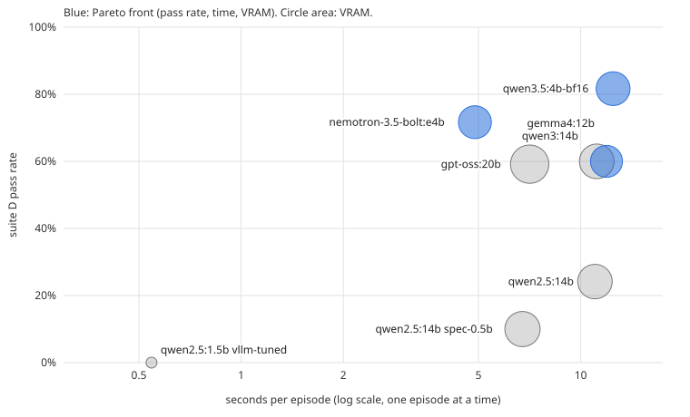

# Phase 10 - The final benchmark

Technical notes. Which model and configuration should actually run the
user's agent on this card (RX 7800 XT gfx1101 16 GB, Ryzen 5 5600X, 32 GB
RAM, Windows 11), and what the choice costs. Every earlier phase measured one
variable at a time on Qwen2.5; this one scores quality on an absolute,
code-checked scale and measures time and VRAM on the same workload, across
current models from five vendors.

Date: 2026-10-26 to 2026-10-27. Ollama 0.40.11 (bundled llama-server, ROCm),
vLLM 0.29.0 in WSL2 with Phase 9's TunableOp GEMMs. Sampling pinned on every
request: temperature 0, seed 42, all penalties 0, `num_ctx` 8192, `think`
off for every model that reasons by default (`"low"` for gpt-oss, which takes
no boolean). Plan with predictions: `phase10-plan.md`. Code:
`phase10-final-benchmark/`. The report below is `04_report.py`'s output
(saved in `logs/p10-report.md`).

---

## Result in one paragraph

**qwen3.5:4b (BF16) is the most accurate model for the agent, and
nemotron-3.5-bolt:e4b is the fastest good one.** On 60 multi-turn mailbox
episodes shaped like the agent's triage work, qwen3.5:4b finishes 82%
correctly, nemotron 72% (the difference is not significant, p = 0.18), and
a group of 12-20B models from three vendors sits at 60%. qwen3.5 is
significantly better than that group (p < 0.005). nemotron does a whole
episode in 4.9 s against qwen3.5's 12.5 s, so it completes 2.2x as many
correct episodes per hour. Every Qwen2.5 model, the lab's subject in Phases
1-9, is at 25% or below on this task, including the 14B, so the choice of
model family matters more than any optimization the lab measured. Running
several episodes at once bought nothing on Ollama for any model that is
good at the task, for three separate reasons found below.

---

## The benchmark

Five suites, all generated with a fixed seed and checked by code, not by a
judge model (`gen_suites.py`, `mailbox.py`):

| suite | items | what it scores |
|---|---|---|
| A reasoning | 200 | arithmetic and logic word problems with one exact answer |
| B extraction | 150 | JSON fields pulled from messy email text, incl. corrections |
| C tool choice | 150 | one turn: the right tool with the right arguments |
| D episodes | 60 | a mock mailbox, the agent's real tools; the model must triage every message **and then stop** |
| E long context | 45 | a planted fact recalled from 2k-6k tokens of filler |

Suite D is the one that matters. It mirrors the agent's mail tools, and an
episode counts only if every message is categorized, the right ones are
replied to or escalated, nothing is invented, and the model ends the loop by
itself, which is the agent's real bug (see Phase 1's notes on it). "Fully
right" is the headline everywhere; partial scores are stored but not ranked.

Suite D ran twice (run groups `p10-quality`, `p10-d-repeat`) for the
shortlist, to measure repeatability.

---

## Quality: the leaderboard

Fully right, with Wilson 95% intervals. Ollama unless marked vLLM.

| model | A reasoning | B extraction | C tool choice | D episodes | E long context |
|---|---|---|---|---|---|
| qwen3.5:4b-bf16 | 92% (87-95) | 47% (40-55) | 97% (92-99) | **82% (70-89)** | 100% |
| nemotron-3.5-bolt:e4b | 80% (73-85) | 99% (95-100) | 89% (83-93) | **72% (59-81)** | 100% |
| gpt-oss:20b | 74% (68-80) | 99% (96-100) | 80% (73-86) | 62% (49-73) | 98% |
| qwen3:14b | 68% (62-75) | 79% (71-84) | 89% (83-93) | 62% (49-73) | 98% |
| gemma4:12b | 82% (77-87) | 100% (98-100) | 92% (87-95) | 60% (47-71) | 100% |
| ministral-3:14b | 73% (66-79) | 100% (98-100) | 39% (32-47) | 37% (26-49) | 98% |
| qwen2.5:14b | 80% (74-85) | 99% (96-100) | 85% (79-90) | 25% (16-37) | 100% |
| qwen2.5:7b Q8_0 | 62% | 69% | 85% | 18% | 100% |
| qwen2.5:3b | 58% | 39% | 84% | 12% | 98% |
| qwen2.5:7b | 60% | 69% | 91% | 8% | 98% |
| qwen2.5:3b Q8_0 | 64% | 54% | 85% | 2% | 100% |
| qwen2.5:1.5b | 37% | 77% | 71% | 0% | 93% |
| gemma3:12b | 76% | 97% | no tools | no tools | 80% |
| llama3.1:8b | 51% | 99% | 76% | 0% | 60% |
| qwen2.5-1.5b (vLLM) | 44% | 67% | 73% | 0% | 76% |
| qwen2.5-3b (vLLM) | 62% | 51% | 87% | 0% | 96% |

What the single-turn suites hide: A, B, C and E barely predict D. qwen2.5:14b
is among the best on A, B and E and respectable on C (85%), and still fails
three episodes in four, because it stops early or writes garbage where a tool call should
start (below). The only suite that ranks models the way D does is C, and only
loosely.

### Suite D, paired against the leader

McNemar's exact test runs on the 60 distinct episodes. The repeat is not an
independent sample: most models give the same answer to an episode both
times, so pooling 120 rows would count each disagreement twice. Pooling them
for the first draft of this report made qwen3.5 vs nemotron look significant
(p = 0.036); paired on the 60 episodes it is p = 0.18.

| model | D, both runs | 95% interval | episodes that flipped between runs | only leader right | only this model right | p |
|---|---|---|---|---|---|---|
| qwen3.5:4b-bf16 | 82% (98/120) | 74-88% | 0 | - | - | - |
| nemotron-3.5-bolt:e4b | 72% (86/120) | 63-79% | 0 | 10 | 4 | 0.18 |
| qwen3:14b | 60% (72/120) | 51-68% | 2 | 14 | 2 | 0.004 |
| gemma4:12b | 60% (72/120) | 51-68% | 0 | 14 | 1 | 0.001 |
| gpt-oss:20b | 59% (71/120) | 50-68% | 9 | 14 | 2 | 0.004 |
| qwen2.5:14b | 24% (29/120) | 17-33% | 7 | 34 | 0 | 1e-10 |
| qwen2.5:1.5b | 0% (0/120) | 0-3% | 0 | 49 | 0 | 4e-15 |

Repeatability at temperature 0 is not a given: gpt-oss changed its answer on
9 of 60 episodes between two identical runs (its "low" reasoning still varies
with batch numerics), the 14B on 7.

### Why the failures happen

- **qwen2.5:14b Q4_K_M** writes Russian, Thai or CJK text where `<tool_call>`
  should start, even on a single turn. It is identical on CPU and GPU with the
  same top-5 logprobs, so it is the weights, not the kernels; Qwen's own
  template (the `ollama-raw` backend, bypassing Ollama's) does not help (15%
  vs 25%).
- **Small Qwen2.5 (1.5B, 3B)** handle one email, often with parallel calls,
  then answer in prose and stop. On Ollama the 1.5B also loses calls outright:
  it writes `{"name": "mail-get-unread"}` with no `arguments` key and Ollama's
  parser drops the call silently. The same 0% on vLLM, whose parser keeps it,
  shows the model, not the parser, is the limit.
- **ministral-3:14b**: 79 of 91 C misses are Mistral's native
  `name[ARGS]{...}` format, which Ollama 0.40.11 leaves as text in single-turn
  replies. That is a parser gap, so C undersells it; its D 37% is genuine
  (early stops, missing categories).
- **gpt-oss:20b** answers in text instead of calling a tool on 22 of its 30 C
  misses.
- **qwen3.5:4b's** B score (47%) is a format habit, not misreading: its
  field-level score is 0.89. It rewrites values (dates, casing) that the
  checker wants verbatim.
- **gemma4:12b** calls `mail-get_unread` (one hyphen turned underscore) on its
  first call in every run. One at a time it reads the "unknown tool" error and
  recovers; see concurrency below.

---

## Cost

Measured on the first 20 D episodes, one at a time, in interleaved blocks of
5 so drift between models cancels (`03_cost.py`). D pass rate is the
120-episode figure where it exists. VRAM is the runner process's dedicated
usage while serving; correct/hour is pass rate x episodes per hour.

| model | config | D pass | s/episode | s/turn | VRAM | correct/hour | at once (episodes/min) | front |
|---|---|---|---|---|---|---|---|---|
| nemotron-3.5-bolt:e4b | Ollama default | 72% | 4.9 | 0.31 | 9.1 GB | **528** | 1: 12.3, np4: 11.5, np16: 5.8 | yes |
| gpt-oss:20b | Ollama default | 59% | 7.1 | 0.46 | 12.4 GB | 301 | np4, np16 do not fit | |
| qwen3.5:4b-bf16 | Ollama default | **82%** | 12.5 | 0.89 | 9.6 GB | 236 | 1: 4.8, np4: 4.5, np16: 4.3 (queued) | yes |
| qwen3:14b | Ollama default | 60% | 11.1 | 0.70 | 10.1 GB | 194 | do not fit | |
| gemma4:12b | Ollama default | 60% | 11.9 | 0.77 | 8.6 GB | 181 | np4: 8.5 but answers break | yes |
| qwen2.5:14b | Ollama default | 24% | 11.0 | 1.49 | 10.0 GB | 79 | do not fit | |
| qwen2.5:14b | + 0.5B draft | 10% (n=20) | 6.7 | 1.13 | 10.4 GB | 53 | - | |
| qwen2.5:1.5b | vLLM tuned | 0% | 0.5 | 0.24 | WSL | 0 | c4: 373, c16: 896 | |

The Pareto front over (D pass rate, s/episode, VRAM) has three members:
qwen3.5:4b for accuracy, nemotron for speed, and gemma4 because it is the
smallest (8.6 GB). gpt-oss and qwen3:14b are each beaten on all three axes by
nemotron. A configuration that never finishes an episode is excluded from the
front, however fast.

An episode is 14-16 turns for the good models; an output of 400-580 tokens in
total; prefill is 11-30% of the time. The models that stop early look cheap
per episode (the 14B averages 7.4 turns, the vLLM 1.5B 2.3) because they did
less of the work.

### Against Phase 7's 32B

Phase 7 measured a 2,000-token prompt + 200-token reply at 5.5 s on the 14B
fully on the GPU and 52.9-55.5 s on the 32B, which does not fit and pages over
PCIe. The turns here are smaller (the context grows by a tool result per
turn), but the ratio is the point: the 32B would turn nemotron's 4.9 s
episode into roughly 50 s, for a model family (Qwen2.5) whose 14B scores 25%.
Whether the 32B is worth it stays formally open, since it is not on disk, but
nothing here suggests that more Qwen2.5 parameters is the fix: the 14B beats
the 7B by 7-17 points on D and loses by 57 to a newer 4B.

### Running episodes at once bought nothing on Ollama

Phase 9 measured `NUM_PARALLEL` giving 1.75-1.9x aggregate throughput. On this
workload it gave nothing for any model worth running, for three different
reasons (`cost_checks.py`):

1. **qwen3.5 is forced to one slot.** Ollama 0.40.11 starts the runner with
   `-np 1` for architecture `qwen35` whatever `NUM_PARALLEL` says; the only
   trace is a WARN in the server log ("model architecture does not currently
   support parallel requests"). Requests queue. llama-server run directly
   batches it fine: x3.0 aggregate decode at 4 requests (a Q8_0 copy x3.45;
   dense qwen2.5:3b x2.6 as a control).
2. **nemotron ships with its own draft model.** Its Ollama Modelfile bundles a
   draft (`--spec-draft-n-max 7`). Acceptance is 23% one at a time, which
   gains nothing (91 vs 93 tok/s without it), and 7% at 4 requests, where it
   kills batching: x1.08 aggregate with the draft vs x2.90 without.
3. **gemma4 breaks under batched decode.** At np4 its episodes rise to 8.5/min
   but 4 of 8 flip to wrong: it repeats `mail-get_unread` three times and the
   loop detector ends the episode. np4 sent one at a time is identical item by
   item to the sequential run, so the 4-slot setup is not the cause; the
   numerics of batched decode are.

gpt-oss, qwen3:14b and qwen2.5:14b do not fit 4 slots of 8192 tokens at all
(0.9-2.6 GB spills into shared system memory).

vLLM's scheduling works as Phase 9 found (896 episodes/min at 16 at once on
the 1.5B), but on this card it was only run with the Qwen2.5 models, which
cannot do the task. Getting a current model under vLLM on gfx1101 is untested.

---

## Answers to the questions earlier phases left open

- **Phase 6: is qwen2.5 7B Q4_K_M better than 3B Q8_0 at a similar
  footprint?** Yes where the two can be told apart, and never worse: B 69% vs
  54% (p = 0.011), C 91% vs 85% (p = 0.08), D 8% vs 2% (p = 0.13), A and E
  level. Parameters beat bits at this size, as Phase 6's fidelity numbers
  predicted. But both are far below the 4B models of the current generation,
  so the question no longer decides anything.
- **Phase 7: is the 32B worth ~10x per turn?** Not measured (not on disk).
  The evidence above points away from it: model generation moved D from 25%
  to 82% at a third of the 14B's parameters.
- **Phase 9: which optimizations hold on a real task?**
  - *Speculative decoding* (14B + 0.5B draft): 39% faster per episode, as
    Phase 9 predicted, but the pass rate fell from 20% to 10% on 20 episodes.
    That is within noise at n = 20 (and verification is not bit-exact against
    plain decode under batched numerics), but it is not evidence for using it.
    The bundled draft on nemotron gains nothing either.
  - *NUM_PARALLEL*: no gain, for the three reasons above. It is a per-model
    question now, not a setting.
  - *TunableOp on vLLM*: holds (fast), on models that fail the task.
  - *q8_0 KV cache*: not exercised; at 8192 context every shortlisted model
    fits without it.
- **Cleanup plan, Stage 2:** the Q8_0 and FP16 Qwen2.5 references can go.
  **Keep `qwen3.5:4b-bf16`** (listed in Stage 2) until a Q8_0 or Q4_K_M of it
  has been scored on D; it is the recommendation. `logs/qwen35-4b-q8_0.gguf`
  (4.3 GB, made for the decode check) can be deleted.

---

## Recommendation for the agent

| use | model | settings |
|---|---|---|
| one agent loop, correctness first | **qwen3.5:4b** (BF16 measured; Q8_0 the first thing to score) | Ollama, `think: false`, temperature 0, `num_ctx` 8192, pin `presence_penalty` 0 (its Modelfile sets 1.5) |
| throughput, or latency per turn | **nemotron-3.5-bolt:e4b** | Ollama, `think: false`, same options; the bundled draft is dead weight but harmless one at a time |
| several loops at once | no measured option on Ollama | qwen3.5 queues; nemotron's draft blocks batching; a Modelfile without the draft, or llama-server directly, is the next thing to try |

Per turn that is 0.3-0.9 s against the 32B's ~53 s in Phase 7. For the
agent's code, independent of model: return an error that lists the valid
tool names on an unknown tool (gemma4 recovers with it), treat an empty reply
with tokens generated as a dropped tool call, and set `think` explicitly.

---

## Predictions against results

| prediction (plan) | result |
|---|---|
| qwen2.5:14b or qwen3:14b is the choice for one agent loop | wrong: a 4B of the newest generation, and a 4B-class NVIDIA model |
| 7B Q4 is the knee of the curve | wrong question: every Qwen2.5 is at <=25% on D |
| NUM_PARALLEL helps fan-out | no, for three model-specific reasons |
| speculative decoding speeds the 14B | yes, 39% per episode |

---

## The code

| file | what it does |
|---|---|
| `common.py` | candidates, pinned options, think handling, Ollama client |
| `01_preflight.py` | does each model load, call tools, honour enums |
| `gen_suites.py` | generates suites A, B, C, E (fixed seed) |
| `mailbox.py` | suite D: mock mailbox, tools, episode checker |
| `02_quality.py` | runs suites on Ollama, Ollama-raw or vLLM; resumes; `--report` |
| `03_cost.py` | Stage 2: time, VRAM and fan-out per configuration |
| `cost_checks.py` | the three fan-out follow-ups |
| `04_report.py` | this report and `docs/phase10-pareto.svg`; no new runs |
| `evaluate.py` | the end product: scores a new Ollama tag end to end (see below) |

---

## Limitations

- One task family (mail triage). The ranking is for this agent, not a general
  one; suite B already shows qwen3.5 losing where nemotron wins.
- Suite D has 60 episodes; neighbours closer than ~10 points cannot be
  separated, which is why qwen3.5 vs nemotron stays open.
- Each model was run at one quantization, mostly Ollama's default tag. qwen3.5
  ran at BF16 (9.6 GB); its Q4_K_M would be about a third of that and faster,
  and Phase 6 found it sound on the 60-question set, but not on D.
- Ollama 0.40.11's tool parsers differ per model family, so some
  differences (ministral's C) are Ollama's, not the model's.
- Cost was measured on 20 episodes and fan-out on 8 and 32.

## Open items

- Score the Q8_0 and Q4_K_M of qwen3.5:4b on D, and nemotron without its
  bundled draft, one at a time and at np4.
- A current model on vLLM on this card.
- Run `evaluate.py` on each new release that fits 16 GB. A first `--quick`
  look at gemma4:e4b (installed, never scored) gave D 6/10. Like nemotron,
  it ships with its own draft model.

## The evaluation tool

The useful question is no longer which Qwen2.5 to run. It is which new release
is worth switching to. `evaluate.py TAG [--pull] [--quick]` answers that on
exactly the footing above, and `evaluate.py --report` prints the leaderboard
over Phase 10's models plus every tag evaluated since. Writing the tool came
down to automating each trap this phase fell into by hand:

| step | what it does | the trap it catches |
|---|---|---|
| detect | reads `ollama show` and writes `candidates.json` | gemma4 listed by hand as not thinking, which wasted a run; gpt-oss's think taking only levels; nemotron's bundled draft; qwen3.5's presence_penalty 1.5 |
| preflight | one tool call, plus think on and off | gemma3 refusing tools; ministral's calls left as text; think:false that still thinks |
| quality | suites A-E, run group `eval` | - |
| repeat | D again, run group `eval-d-repeat` | gpt-oss flipping 9 of 60 episodes between identical runs |
| cost | 20 episodes one at a time, 8 at np4 (`eval-cost.json`) | Ollama forcing `-np 1` (qwen3.5); spilling into shared memory (the 14b); answers changing under batched decode (gemma4) |

Warnings go to `logs/eval.json` and print with the report. `--quick` (10 items
per suite, run group `eval-quick`) is a first look in about two minutes, and it
is kept out of the leaderboard.
